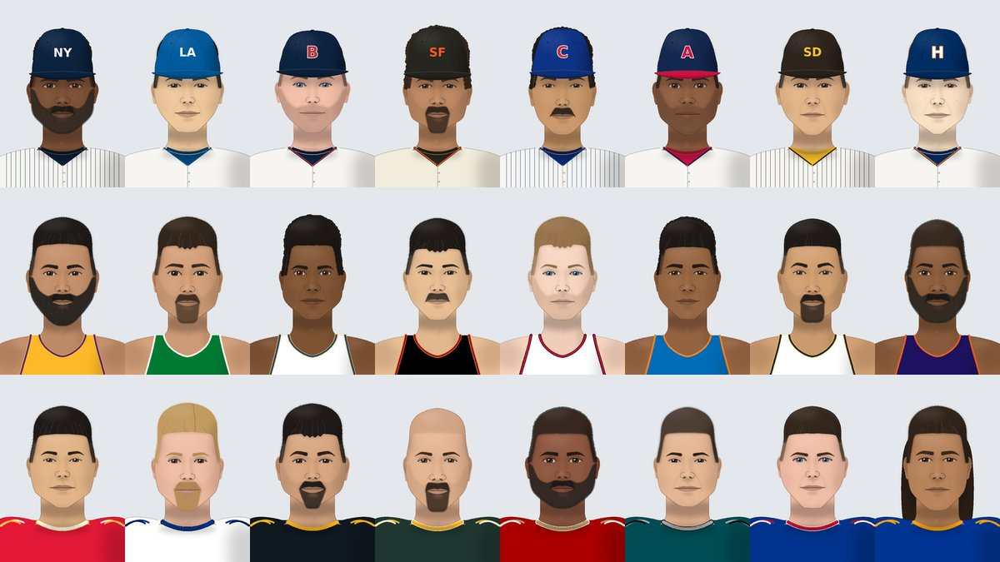

# SimFace

A face generator and portrait automater for baseball, basketball and football sims, built on the same ideas as
OOTP's FaceGen setup:

- **Real players** with a headshot get their actual face, cel-shaded so it looks a little animated, cut out and
  dropped into an illustrated uniform in their real team's colors (with the team cap for baseball).
- **Generated players** (draft classes, fictional leagues) get an illustrated face drawn from OOTP's model:
  nation → ethnicity mix → one of five facial types → a face "genome".
- Every player's genome is saved in a **face bank**, so a player keeps the same face for his whole career. Only
  age, weight and team change from season to season.



*All faces above are generated. None are real people.*

SimFace doesn't use or need Singular Inversions' FaceGen (OOTP licenses that; it isn't available to
other programs). It is its own generator that follows OOTP's model and file conventions.

## Install (macOS)

```sh
python3 -m venv .venv && source .venv/bin/activate
pip install -e ".[photo]"        # drop [photo] if you only want generated faces
```

Python 3.10 or newer. The core needs only Pillow. Photo mode adds OpenCV and NumPy. The face detector (YuNet,
MIT license) ships in `simface/data`.

## Quick start

```sh
# OOTP: player_<id>.png at 90x135 with the team cap and jersey
simface generate players.csv --preset ootp --season 2026 --out "path/to/league/photos"

# Basketball and football sims (300x450 by default; --size to change)
simface generate nba_roster.csv --preset basketball --lookup espn --out portraits/nba
simface generate nfl_roster.csv --preset football --kit away --out portraits/nfl

# Try a team's look without a roster
simface preview --preset baseball --team NYY --count 16 --out yankees.png
```

Each run writes `index.html` (a gallery of everything it made) and `simface_bank.json` (the face bank) into the
output folder. Try it on the bundled examples: `simface generate examples/mlb_roster.csv --preset ootp --out out`.

| Preset | Uniform | Size | File name |
| --- | --- | --- | --- |
| `ootp` | cap + button-front jersey | 90x135 | `player_{id}.png` |
| `baseball` | cap + button-front jersey | 300x450 | `{id}.png` |
| `basketball` | tank top | 300x450 | `{id}.png` |
| `football` | jersey over shoulder pads, no helmet | 300x450 | `{id}.png` |

Any of it can be overridden: `--size 180x270`, `--format svg`, `--filename "{last}_{first}.png"`,
`--uniform crew`, `--headwear none`, `--background "#e5e7eb"`.

## Real players: headshots

For each player SimFace looks for a headshot in this order:

1. a `photo_url` column in the roster (a URL or a local file path);
2. an ID column: `espn_id` (ESPN's image CDN), `mlbam_id` (MLB's image server) or `nba_id` (NBA's CDN);
3. with `--lookup espn`, a name match (and team, when two players share a name) against ESPN's public team
   rosters for that league.

If there's no photo, or no face can be found in it, the player gets a generated face instead. `--photos only`
renders just the players with photos, and `--photos off` ignores photos entirely.

To check the matches before rendering, write them into the roster first:

```sh
simface lookup-photos nba_roster.csv --preset basketball --out nba_with_photos.csv
```

`--toon` sets how cartoon-like the photos look: 0 is the real photo, 1 is fully cel-shaded, and the default is
0.7. Downloads and processed heads are cached in `~/.cache/simface`, so re-runs are fast.

These are the free endpoints that ESPN's and the leagues' own websites use. They aren't official APIs and can
change without notice, and the photos belong to their owners, so keep the results to your own games.

## Teams and uniforms

All 30 MLB, 30 NBA and 32 NFL teams are built in (`simface teams --league nfl`), with home and away kits:

- **MLB:** home whites (with pinstripes for the Yankees, Cubs, Phillies, Mets, White Sox, Rockies and Padres),
  road grays, and real cap colors.
- **NBA:** white Association jerseys at home and Icon colors away.
- **NFL:** colored jerseys at home, except Dallas, which wears white.

The roster's team column can hold an abbreviation (`NYY`, `CHW`), a nickname (`Lakers`) or a full name. Caps use
text such as "NY" or "LA" in place of the real logos. Edit `simface/data/teams.json` to change any colors.

For your own teams, pass `--teams my_teams.csv`:

```csv
team_id,city,name,primary,secondary,logo,cap,jersey,trim,pinstripes
7,Springfield,Comets,#112233,#ffcc00,SC,,,,
```

Teams that don't match anything still get consistent colors, picked from the team name.

## Generated players: the OOTP model

Like OOTP, every generated face comes from one of five facial types: `african`, `asian`, `caucasian`,
`east_indian` and `hispanic`. The mix comes from the player's nation through ethnicity tables, which use OOTP's
1000-point scale and its column order. US-born players use a different mix for each league, so a generated NBA
draft class doesn't look like an MLB one. See the tables with `simface world`.

**Dropping in your decoded OOTP data:** put your ethnicities and nations in a JSON file in the same layout as
`simface/data/world.json` and pass `--world`. Your entries replace or add to the defaults. Ethnicities can be
written exactly as OOTP stores them:

```json
{
  "ethnicities": { "Canadian": [60, 70, 810, 30, 30] },
  "nations": { "Canada": { "aliases": ["CAN"], "ethnicities": { "Canadian": 1000 } } },
  "facial_types": { "pacific_islander": { "base": "hispanic", "skin_tone": [0.5, 0.08] } }
}
```

If your roster has OOTP's numeric `nation_id`, add `--nations nations.csv` (OOTP's nations dump) to turn the
IDs into names. A `facial_type` column (a name, or OOTP's 0–4) skips the nation lookup entirely.

## Roster columns

Column names are matched loosely (case and punctuation don't matter). Use `--map field=Column` for anything else.

| Field | Recognized names (examples) |
| --- | --- |
| id | `player_id`, `pid`, `id` |
| name | `first_name` + `last_name`, or `name` |
| age | `age`, or `date_of_birth` / `born` with `--season` |
| height, weight | `height` (6-2, 74 in, 188 cm), `weight` (lb, or kg with `--metric`) |
| nation | `nation`, `country`, `nationality`, `birthplace` ("Austin, TX" works) |
| team | `team`, `team_abbr`, `team_id` |
| photo | `photo_url`, `headshot`, `img_url`, `espn_id`, `mlbam_id`, `nba_id` |
| look (optional) | `facial_type`, `ethnicity`, `sex`, `skin_tone` (0–1), `hair_color`, `eye_color`, `hair_style`, `facial_hair` |

ZenGM league exports (Basketball GM, Football GM, ZenGM Baseball) can be read directly: the season, teams,
`born.loc`, `hgt` and `imgURL` are all picked up.

## Season to season

- Re-run `generate` with next season's roster. Existing players keep their genome and are re-rendered at their
  new age, so they gain wrinkles and gray hair and their hairlines recede. New players get new faces. Weight
  changes widen or slim the face. Trades put players in the new team's kit.
- `--only-missing` only draws players who don't have a picture yet, like OOTP's "generate missing pictures".
- `--restyle-chance 0.15 --season 2027` gives about 15% of players a new haircut or beard that season.
- SimFace **never overwrites a picture it didn't make**, such as one from a photo pack. `--force` overrides
  that.
- The same `--seed` and player ID always produce the same face, so leagues can be rebuilt from scratch.

## Python API

```python
import random
from simface import generate_genome, build_portrait, RenderContext
from simface.backends import render_png
from simface.teams import TeamDB

team = TeamDB.load_default().find("LAL", "nba")
genome = generate_genome(random.Random(7), "african")
ctx = RenderContext(age=24, bmi=24, uniform="tank", **team.kit("home"))
open("player.png", "wb").write(render_png(build_portrait(genome, ctx), (300, 450)))
```

## Development

```sh
pip install -e ".[photo,dev]" && pytest
```

The tests use SimFace's own drawn faces as stand-in photos, so the repo contains no pictures of real people.
